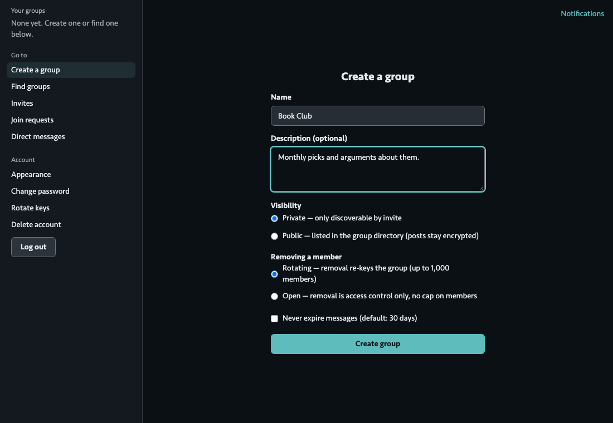
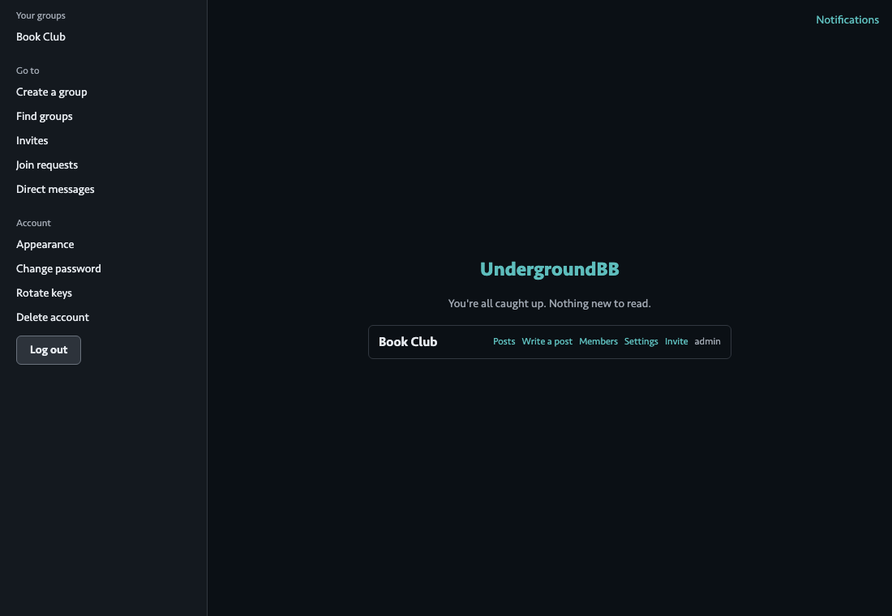
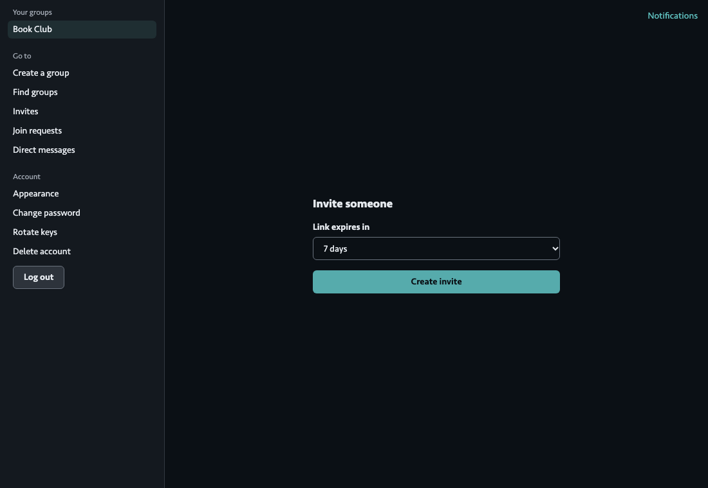
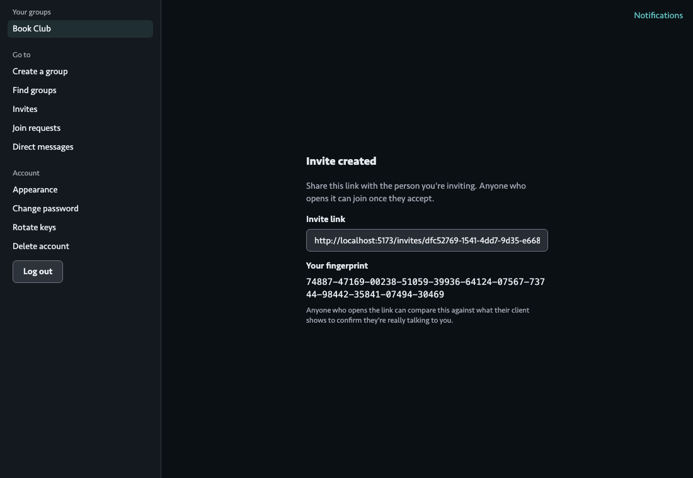
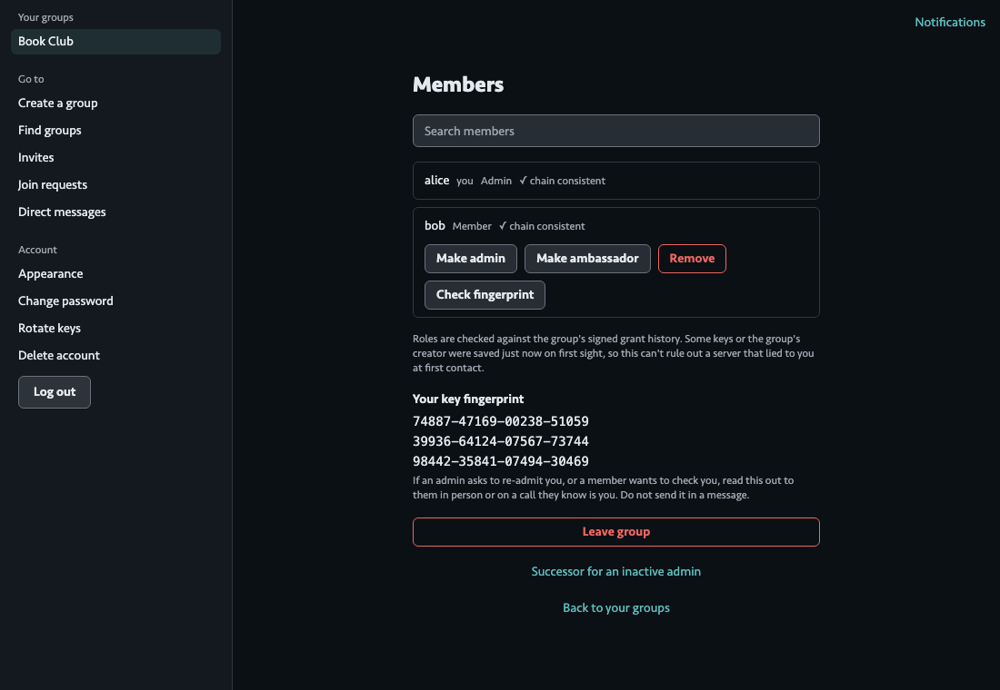
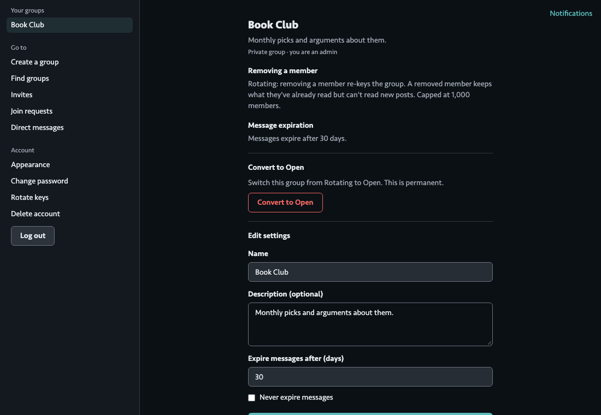

# Group admin guide

This guide is for the people who run a group: the person who creates it, and anyone they make an admin or ambassador. It covers setting a group up, bringing people in, looking after the member list, and making sure the group survives if its admins go quiet.

UndergroundBB has no site-wide admin. Nobody can read a group, remove someone from it or change its settings unless they hold a role in that group. The person who runs the website (the operator) looks after the servers, cost limits and alarms, and that work is in [Self-hosting](SELF_HOSTING.md). If you only want to take part in a group, read the [User guide](USER_GUIDE.md) instead. For why the app works this way, see [How it works](HOW_IT_WORKS.md).

The screenshots show two test accounts, Alice (the admin) and Bob, on a local copy of the app.

## Who can do what

Every member of a group has one role.

| | Member | Ambassador | Admin |
| --- | :---: | :---: | :---: |
| Read, post, comment, react | yes | yes | yes |
| Create invite links | | yes | yes |
| Answer join requests (public groups) | | yes | yes |
| Accept and approve a member's changed keys | | in most cases (see [Changed keys](#when-someone-changes-their-keys)) | yes |
| Make someone an admin, ambassador or member | | | yes |
| Remove a member | | | yes |
| Change the name, description and expiry | | | yes |
| Convert a Rotating group to Open | | | yes |
| Name a successor | | | yes |

Everyone can open **Settings** and read it. Only an admin gets the edit form. The server checks these roles itself, so hiding a button is never the only protection.

A group can have any number of admins. Having two or three is a good idea (see [Keep the group alive](#keep-the-group-alive)).

## Set a group up

Choose **Create a group** and fill in the form. The [User guide](USER_GUIDE.md#start-a-group) describes each field. These are the choices that are hard to change later.

- **Visibility** is fixed when you create the group. Private groups are found only through an invite. Public groups are listed in the directory with their name and description, and anyone can ask to join. Posts and member lists stay private either way.
- **Removing a member** decides how much a removal does.
  - *Rotating*: removing someone makes a new group key and gives it to everyone else, so the person removed cannot read anything new. A Rotating group has a member limit, 1,000 unless the operator has set another (see `MAX_ROTATING_GROUP_MEMBERS` in [Self-hosting](SELF_HOSTING.md)).
  - *Open*: no member limit, but removing someone only stops their access going forward. They keep the key, so they could still read new posts if they can get at the group's data some other way. A public group is always Open.
  - A Rotating group can later be converted to Open, but never back. See [Convert to Open](#convert-to-open).
- **Message expiry** is how long posts and comments last. It can be changed later (see [Group settings](#group-settings)).

You are the group's first admin. One thing to know on day one: your admin role counts from the day you get it, and a role change or removal signed on the same UTC day as your own admin grant is refused. On the day you create a group, you can invite people but cannot yet promote or remove anyone. Try again the next day.

Each group on Home has links to **Posts**, **Members**, **Settings**, and, for admins and ambassadors, **Invite**. A public group also shows **Requests** to admins and ambassadors.

## Bring people in

There are two routes. Both put you in the loop, because a new member only gets the group key from someone who already has it.

### Invite links

Choose **Invite** on the group (admins and ambassadors only).

Pick how long the link works for (1, 7 or 30 days) and press **Create invite**.

Send the link to the person through any channel you trust. A few things to know:

- Anyone who opens the link can accept it once, so send it only to the person you mean. If you are worried it was swapped on the way, read your fingerprint (shown on this page) to them on a call. They see it when they open the link and can check it matches.
- The person is not in the group the moment they accept. **The group key is handed over the next time you log in** (the person who created the invite), because your browser has to wrap the key for them. Tell them to expect that delay, and log in when you can. Until then they see the invite under *Waiting on the inviter*.
- You must still be an admin or ambassador of the group when that happens. If you were demoted in the meantime, the invite cannot be completed, and someone else needs to invite them.
- If the group is at its member limit, you cannot create invites. Someone has to leave or be removed first, or the group has to be converted to Open.

**Invites** in the sidebar lists the invites you created and where each one stands: not yet accepted, accepted and due to complete by a date, or overdue. An overdue one is finished by your next login, and if it keeps failing the person needs a new invite. You can revoke an invite there.

### Join requests (public groups)

People can ask to join a public group from the directory. Admins and ambassadors see these under **Requests** on the group's line on Home.

Each request shows the person's username and the day they asked. To answer one:

1. Press **Review**. Your browser shows the fingerprint of the keys they signed their request with.
2. Ask the person for their fingerprint in person or on a call you know is them. They can read it under **Your key fingerprint** on the Members page of any group they are in. Do not take it from a message or from the group.
3. If it matches, press **It matches, approve**. This gives them the group key, wrapped to those keys. If not, press **Cancel** or **Decline**.

There is no invite link to vouch for a requester, so the screen tells you that if you have never seen this person before, you are trusting whoever sent the request on first sight. That is why the call matters.

Other things worth knowing:

- **Decline** is not a ban. The person sees "Declined" and can ask again after 7 days (counted to the end of that UTC day).
- A request nobody answers expires after 90 days.
- If the group is at its member limit, approving fails and the request stays in the queue until a slot is free.
- Any admin or ambassador can answer a request.

## Look after the members

Choose **Members** on the group.

### Change a role

Next to each member (other than you) an admin sees **Make admin**, **Make ambassador** or **Make member**, whichever apply, and **Remove**. You cannot change your own role here. Accounts that have been deleted can only be made a plain member, and not promoted.

Roles are signed. Every change is added to a history that everyone's browser can check, and the page shows **✓ chain consistent** next to a name when the check passes. A role change you make dated on the same UTC day as your own admin grant is refused with a message saying so. The fix is to wait until the next day. This also applies to a new admin: someone you promote today cannot promote or remove anyone until tomorrow.

Use ambassadors for people you trust to bring in and vouch for new members without giving them power to remove anyone or change settings.

### Remove a member

Press **Remove** next to the person, then **Confirm remove**. What happens next depends on the group:

- **Rotating**: the group key is changed and everyone else is given the new one. This takes a little while in a large group. **Keep the page open until it finishes.** The page shows "Working on the group's key rotation" while it runs.
- **Open**: the person loses access going forward, and nothing else changes.

If a rotation is cut short (the tab was closed, or the browser went offline), a red banner says how long ago it started and that, until it finishes, a removed member can still read new posts. It says what to do: reopen the group, enter your password if asked, or ask another admin to open the group. Only an admin who already has the new key can finish it. Take this banner seriously: until it clears, the removal has not fully worked.

Anything the person has already read, they have read. Removing someone cannot take that back.

### When someone changes their keys

A member can rotate their keys under **Rotate keys** (see the [User guide](USER_GUIDE.md#rotate-your-keys)), which they should only do if they think someone else has their keys. It changes their fingerprint, so you will see one or both of these on the Members page:

- **Keys changed since you saved them.** Your browser remembers each member's keys the first time it sees them, and warns you if the server later shows different ones. Press **Accept key change**, check the fingerprint with them in person or on a call, and press **It matches, accept** only if it does.
- **Keys changed, awaiting approval.** The person is still a member but their copy of the group key is wrapped to their old keys, so they cannot read new posts until someone approves the new keys. Press **Approve**, check the fingerprint with them the same way, then **It matches, approve**.

An ambassador can do both of these for most members. The exception is a member in a Rotating group who is still on the group's current key: approving them means making a new group key for everyone, and only an admin can do that. The page says so beside their name.

If a member's invitation record no longer verifies, a **Re-admit** button appears. It needs the same fingerprint check. Admins and ambassadors can do it.

If you are an admin and rotate your own keys, the app re-keys each Rotating group you administer for you straight afterwards, so a group with a single admin does not lock itself.

### Check someone's fingerprint

**Check fingerprint** next to a member compares keys with them. Do it for anyone you rely on, and always before approving anything above. A fingerprint passed along inside the group or in a message proves nothing, because that is the channel an attacker would control.

## Group settings

Open **Settings** on the group.

The top of the page is for everyone: the group's visibility, how removal works and when messages expire. Admins also get **Edit settings**:

- **Name** and **Description** (optional).
- **Expire messages after (days)**: a whole number from 1 to 3,650. Expiry limits how much is exposed if someone gets hold of old data, so use the shortest time the group is comfortable with. **Never expire messages** appears only if the site allows it. If the operator has turned it off, a group that already had it must choose a number of days.

Press **Save changes**. If your tab has lost your keys (for example after a reload), the page asks for your password before it can show or change a private group's name.

### Convert to Open

A Rotating group can be switched to Open. It lifts the member limit and stops removals from changing the key (see [Remove a member](#remove-a-member)). **This is permanent.** You must type the group's name to confirm it. Use it when a group has outgrown the member limit and you accept that a removed member keeps the key.

## Keep the group alive

Because only keys held by members can open a group, a group whose only admin stops logging in can never again change roles, remove anyone or change settings. Two things protect against that.

**Have more than one admin.** Make a second person an admin as soon as you trust them enough.

**Name a successor.** At the bottom of the Members page, **Successor for an inactive admin** opens the successor page.

- Choose a member who is not an admin, and set the days of inactivity from 30 to 365.
- The successor can take over only if you **and every other admin** have not logged in for that many days. Logging in as normal keeps it from ever firing.
- Once the time has passed, the successor sees **Claim admin role** and a confirmation step. The server checks that the admins really were inactive and refuses otherwise.
- You can designate once a day and not on the day you were made an admin. **Revoke** takes the designation back, and naming someone else replaces it.
- A designation lapses on its own if your role changes, the successor leaves, or the successor becomes an admin by another route. The page tells you which.
- A new admin through this route can change roles from the day after they claim. Until then role changes are refused.

**Leaving as the last admin.** If you are the only admin and others remain, **Leave group** asks you to choose who takes over: press **Make admin and leave** next to that person.

## Things the operator does

These are not group tasks and no group role can do them: setting the message-expiry policy for the whole site, changing member limits, the hourly purge of test accounts, the cost guard, alarms and deploying. They are all in [Self-hosting](SELF_HOSTING.md).

## What an admin cannot do

- Read anyone's password, recovery code or private keys.
- Read posts they do not hold the key for, or recover a group's key once every member who held it has gone.
- Take back what a removed member already read.
- Change their own role from the Members page. To step down, use **Leave group**, or ask another admin to change your role.
