# User guide

This guide walks through UndergroundBB as a member: making an account, joining or starting a group, posting, inviting people, and looking after your account. It assumes nothing beyond a web browser. Nothing to install.

Two people appear in the screenshots, Alice and Bob, on a local test copy of the app. Your screen will match, apart from the names and the theme you pick.

For why the app works the way it does, see [How it works](HOW_IT_WORKS.md).

## The one thing to know first

Everything you write in a group is encrypted in your browser with a key only the group's members hold. The server never sees your password and cannot read your posts. That has a cost: **if you lose both your password and your recovery code, nobody can get your account back**, not even the person who runs the site. Save the recovery code when it is shown.

## Create an account

Open the site and choose **Sign up**.

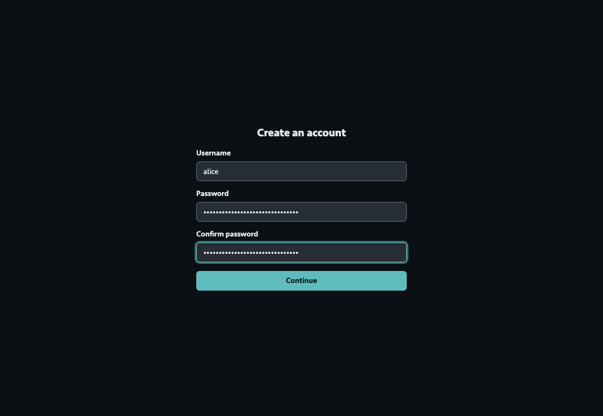

- **Username**: 3 to 32 letters, numbers, `_` or `-`.
- **Password**: at least 8 characters. Longer is better, and a few unrelated words make a good one. Your password never leaves your browser, and a password manager is a good idea.

Press **Continue**. Your browser now makes your keys, which takes a few seconds.

### Save your recovery code

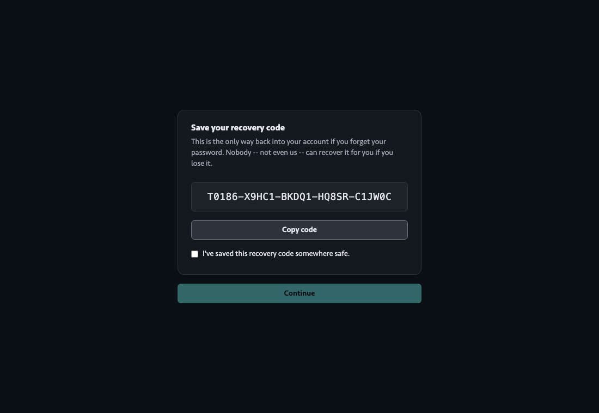

The next screen shows your recovery code. This is the only way back into your account if you forget your password. Copy it somewhere safe (a password manager, a printed page in a drawer), tick **I've saved this recovery code somewhere safe**, and press **Continue**. You cannot move on without ticking the box. The code is shown once.

### Pick a look

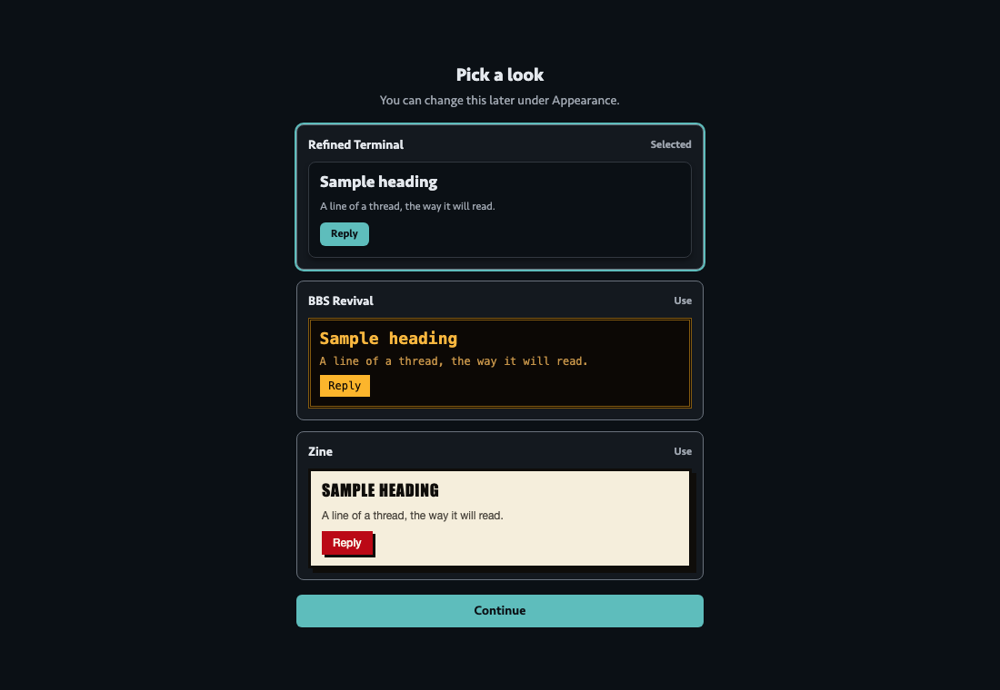

Choose one of the built-in themes, or press **Continue** to keep the default. You can change it any time under **Appearance** (see [Appearance and themes](#appearance-and-themes)).

You land on Home, signed in.

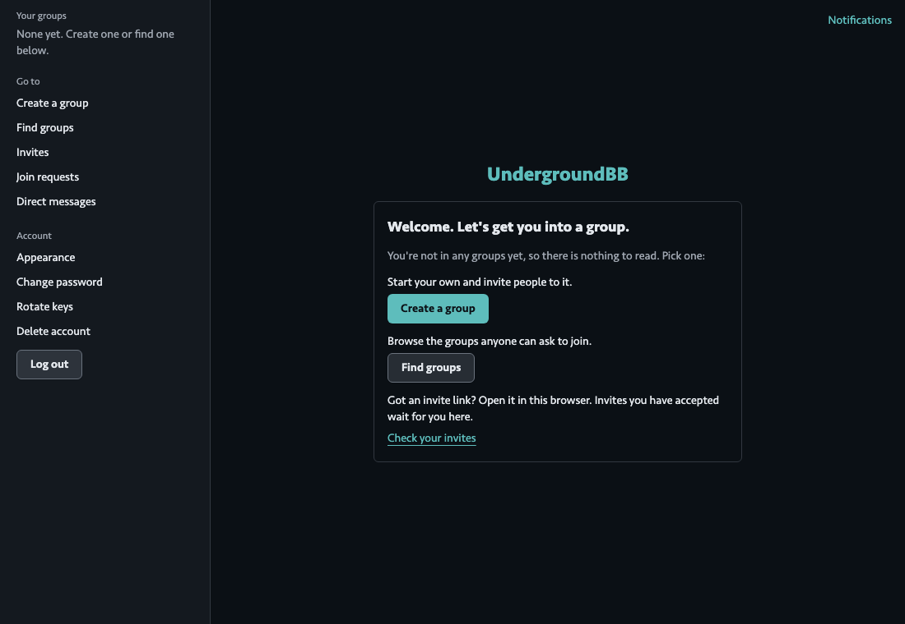

Home has your groups and everything else in the left sidebar.

## Log in, log out, and forgotten passwords

Log in with your username and password from any browser. There is no device pairing. **Log out** is at the bottom of the sidebar.

If you forget your password, choose **Forgot your password?** on the login page. Enter your username, your recovery code and a new password. Recovery gives you a new recovery code at the end, so save that one too and discard the old one.

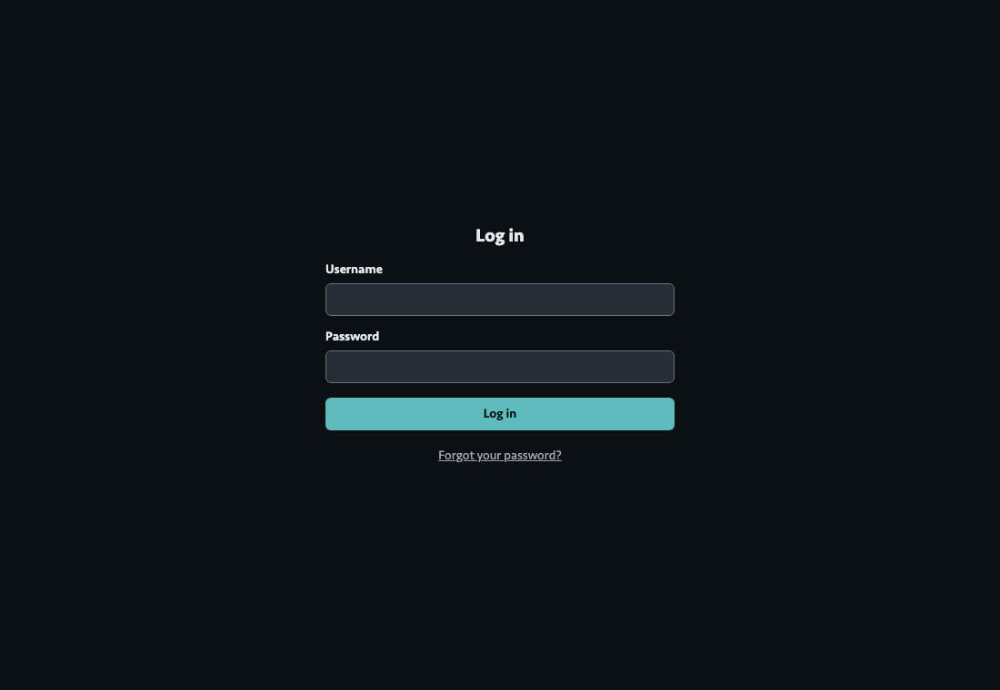

When you load or reload a page, your browser has not got your keys yet. The app then asks for your password again before anything that needs them, such as posting. That is normal and is the app protecting you, not an error.

## Groups

A group is a private room with its own members, posts and key. You can be in as many as you like.

### Start a group

Choose **Create a group**.

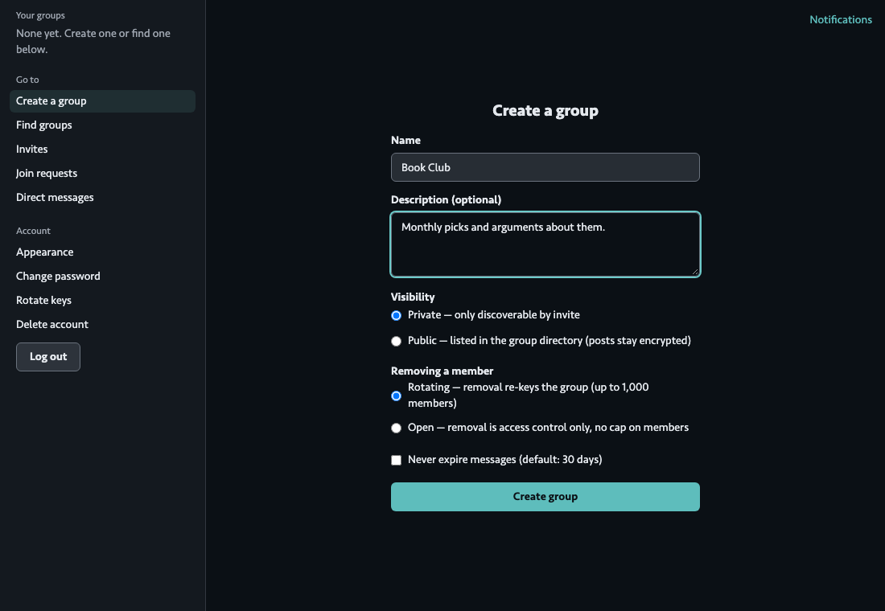

- **Name** is required. **Description** is optional.
- **Visibility**: *Private* groups are found only by invite. *Public* groups are listed in the directory, with their name and description visible to everyone. Posts and member lists stay private either way.
- **Removing a member**: *Rotating* groups re-key the group when someone is removed, so the person removed cannot read anything new. They are capped at 1,000 members. *Open* groups have no member cap, but removing someone only stops their access and does not change the key. Pick Rotating unless you expect a very large group. A public group is always Open, so the choice is not offered for one.
- **Message expiry**: messages expire after 30 days by default. Expiry is a safety feature: it limits what an attacker who gets hold of old data can read. The form also offers *Never expire messages*, if the site allows it. Think twice before choosing it.

Press **Create group**. You are the group's admin, and it appears on Home.

Each group has links to its **Posts**, **Write a post**, **Members**, **Settings** and **Invite**.

### Join a group

There are two ways in.

- **An invite link.** Someone in the group sends you a link. See [Accept an invite](#accept-an-invite).
- **Ask to join a public group.** Choose **Find groups** and search by the start of a name, capital letters included. Your requests are listed under **Join requests**, and a group admin deals with them.

## Posts and comments

### Write a post

Choose **Write a post** on the group.

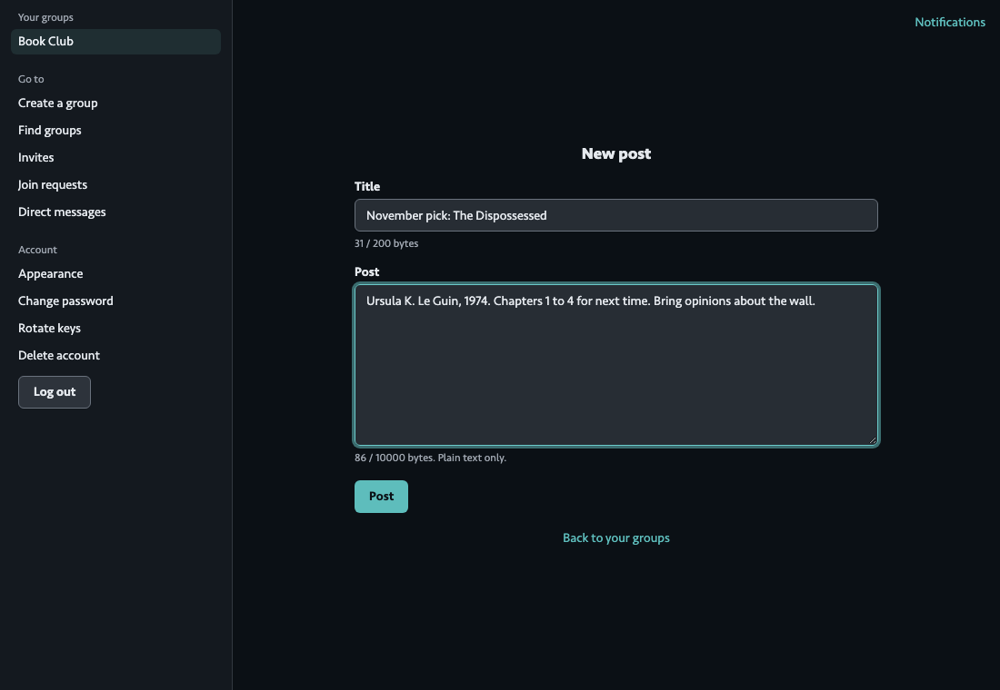

A post has a **Title** (up to 200 bytes) and a body (up to 10,000 bytes). Posts are plain text. Press **Post**. The counters under each box show how much room you have. Non-English text and emoji take more bytes per character, so the counters are in bytes.

### Read and reply

Choose **Posts** to see a group's posts, and **Comments** on a post to open its thread.

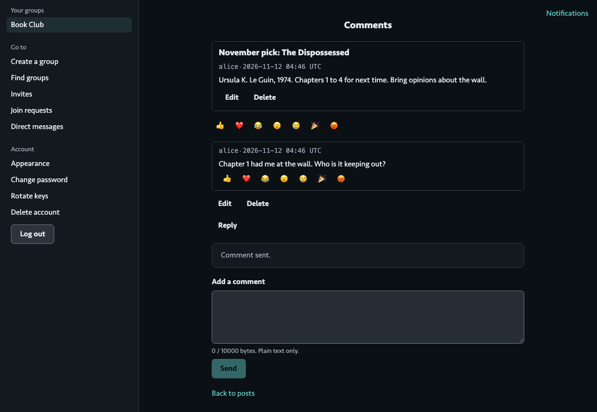

- Write a comment in the box under the thread and press **Send**. Use **Reply** under a comment to answer that comment directly.
- React with one of the seven emoji under a post or comment.
- You can **Edit** or **Delete** your own posts and comments.

The first time you see someone's posts, the app notes their keys and says so ("First time you have seen ...'s keys; they are saved now, so a later change will be caught."). If their keys ever change unexpectedly, you will be warned.

### Messages expire

Posts and comments disappear after the group's expiry time. An admin sets it under **Settings**.

## Invite someone

Choose **Invite** on the group.

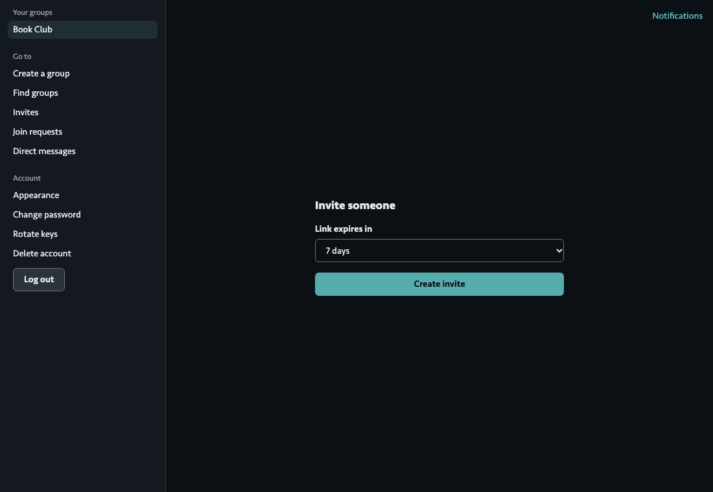

Pick how long the link works for (1, 7 or 30 days) and press **Create invite**.

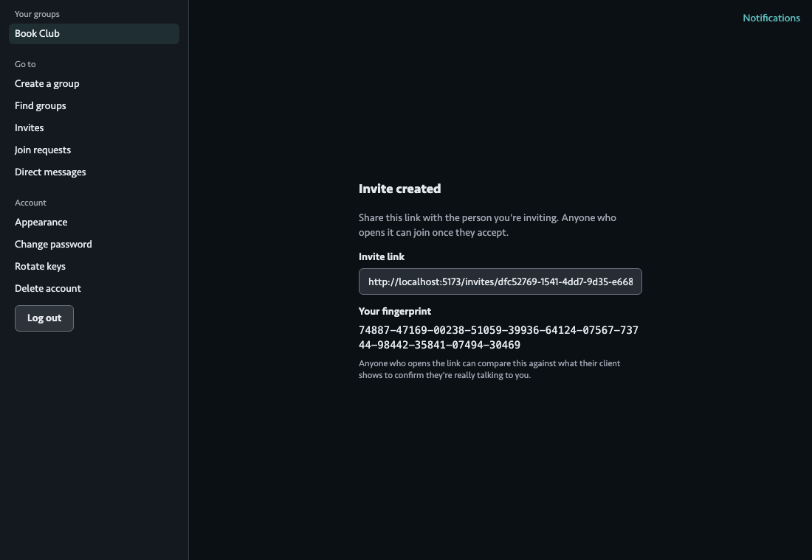

Send the link to the person through any channel you trust. The page also shows **your fingerprint**: a long number that identifies your keys. The person you invite sees it too and checks it matches. If you want to be sure nobody swapped the link on the way, read it out to them in a call you know is them.

The page says that anyone who opens the link can join once they accept, so share it only with the person you mean.

### Accept an invite

Open the link in your browser. If you are signed out, you see the inviter's fingerprint and are told to log in or create an account and then come back to the link. If you are signed in but the page was just loaded, the app asks for your password again before it can accept the invite. The whole link matters, including the part after the `#`, so open it as it was sent.

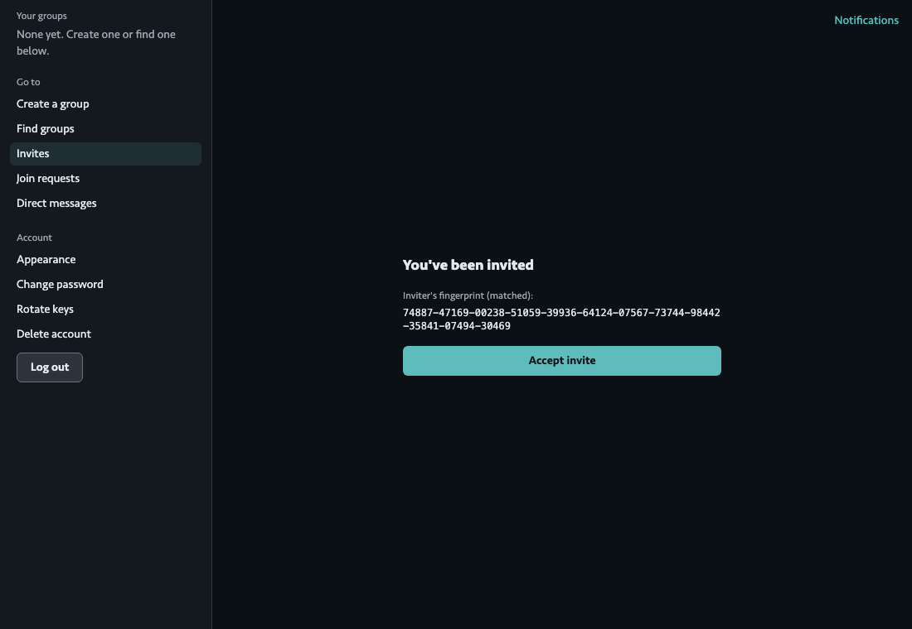

You see the inviter's fingerprint and whether it matched. Press **Accept invite**.

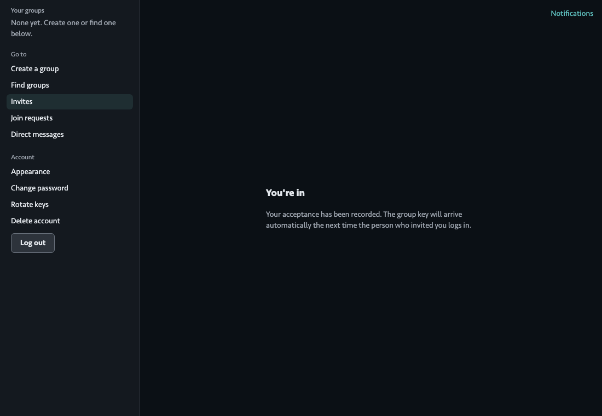

You are not in yet. The group key is handed to you **the next time the person who invited you logs in**. Until then you will find the invite under **Invites**, in *Waiting on the inviter*. This is a design property, not a fault: the key is wrapped to you by the inviter's browser, so it can only happen when they are signed in. Ask them to log in.

Once they have, the group shows up on your Home.

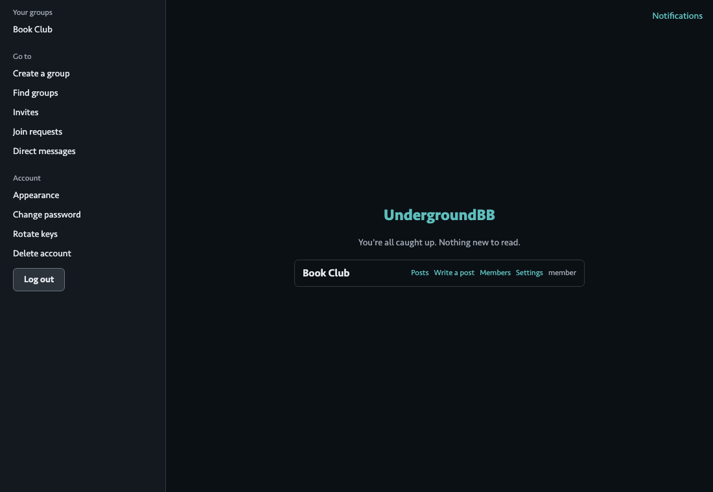

## Members and roles

Choose **Members** on a group.

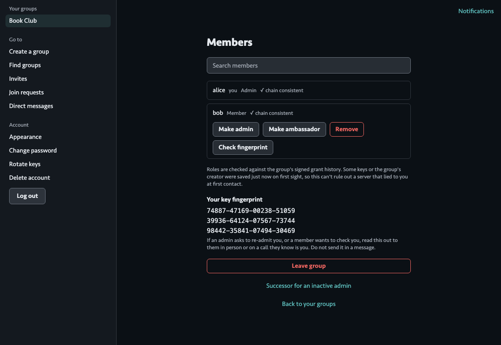

Each member has a role:

- **Admin**: can change roles, remove people, and change the group's settings.
- **Ambassador**: helps admins keep the group running, for example by approving a member whose keys changed.
- **Member**: reads and posts.

Next to each name you may see **✓ chain consistent**. Roles are recorded in a signed history, and your browser checks it. A note on the page explains when the check is only as strong as the first time you saw someone's keys.

As an admin you can **Make admin**, **Make ambassador** or **Remove** a member. Anyone can use **Check fingerprint** on a member to compare keys with them in person or on a call.

### Your fingerprint

The page also shows **your key fingerprint**. If an admin asks to re-admit you, or a member wants to check you, read it to them in person or on a call you know is them. Do not send it in a message.

### Group settings

Admins can open **Settings** on a group.

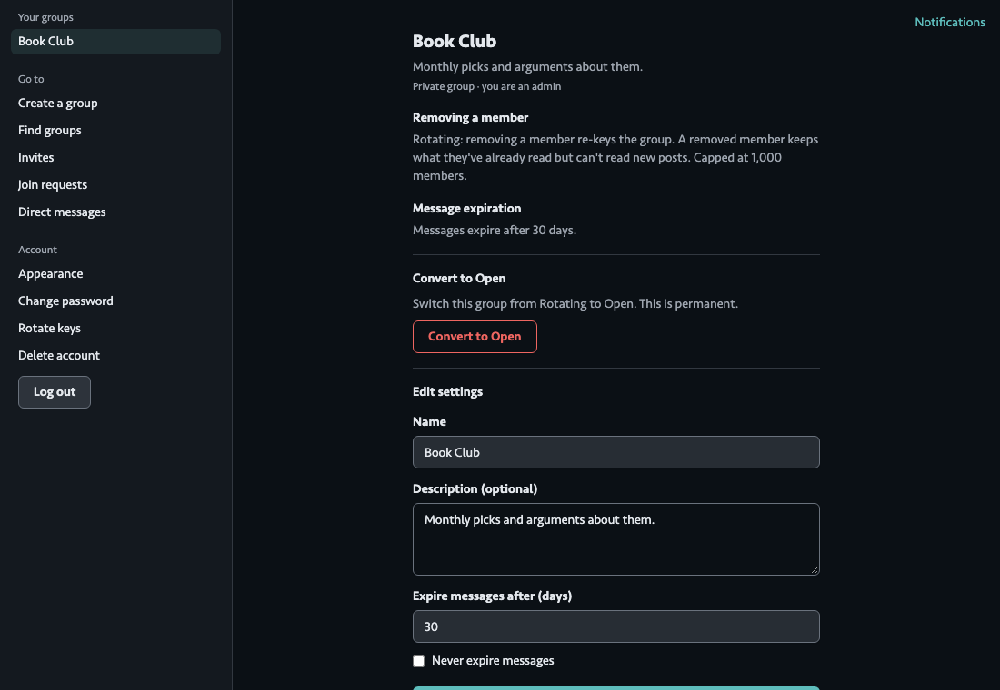

The page summarises the group (its visibility, how removal works and when messages expire) and lets an admin change the **Name**, the **Description** and the **expiry** in days, or turn expiry off if the site allows it. A *Rotating* group can be converted to *Open* with **Convert to Open**. The page says this is permanent, so read it first.

### Leave a group

**Leave group** is at the bottom of the Members page. It asks you to confirm. If you are the only admin and others remain, it asks you to choose who takes over: press **Make admin and leave** next to that person.

## Direct messages

To start a private conversation, open someone's profile from a group's **Members** page and choose **Send a message**. The other person sees your request under **Direct messages** and accepts or declines it. Conversations you started appear in your group list.

## Notifications

**Notifications** (top right) lists replies and reactions to your posts and comments, for example "alice replied to your post in Book Club". It says "Nothing new." when there is nothing.

## Appearance and themes

Choose **Appearance** to change how the app looks.

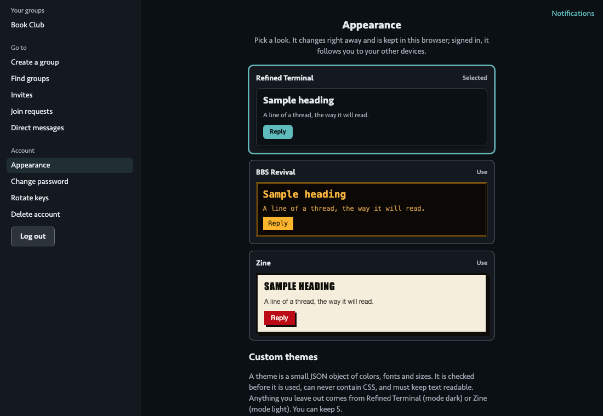

Three themes ship: **Refined Terminal** (the default dark theme), **BBS Revival** and **Zine**. The choice applies at once. Once you are signed in, your choice follows you to your other devices. You can also import your own theme as a small JSON object, checked so it stays readable. See the [theming guide](THEMING.md).

## Your account

### Change your password

**Change password** asks for your current and a new password. It also **issues a new recovery code and invalidates the old one**, so save the new one.

### Rotate your keys

**Rotate keys** is not a password change. Use it only if you think someone else has your keys, for example a lost laptop or malware. It gives you new keys, a new password and a new recovery code, and signs you out everywhere else. Your fingerprint changes, so people who verified you will see a key change and need to accept it. In groups that rotate their keys, you cannot read new messages until an admin approves your new key. You can rotate once a day.

### Delete your account

**Delete account** is permanent. It signs you out everywhere, frees your username and removes your login. Anything other members have already read cannot be taken back from them. You leave every group first, and the page lists them. A group where you are the only member is deleted with everything in it. If you are the last admin of a group that still has other members, the page asks you to make someone else an admin first.

## What the app does not do

- It does not recover an account without your password or recovery code.
- It cannot stop a member from copying or screenshotting what they can read.
- It hides what you write, not the fact that you use it. The [threat model](THREAT_MODEL.md) says exactly what is and is not protected.
